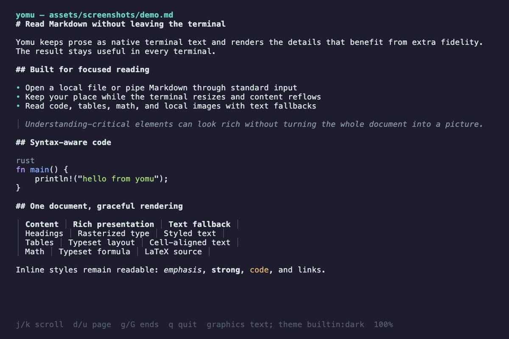

# Yomu

Yomu is a terminal Markdown reader for people who want to read local documents
without leaving the command line. It keeps prose selectable as terminal text
while using terminal graphics for headings, tables, math, and images when the
terminal supports them.



## Why Yomu?

- **Stay in the terminal.** Open a Markdown file or pipe generated content
  directly into a focused, full-screen reader.
- **Read structure, not syntax.** Headings, lists, quotations, code, tables,
  math, links, and inline styles receive distinct, readable presentation.
- **Keep every document usable.** Rich elements retain text fallbacks when a
  graphics protocol is unavailable or rendering fails.
- **Resize without losing your place.** Yomu anchors navigation to the source
  document, so reflow keeps the same logical content in view.

## Install Yomu

The current release provides prebuilt binaries for Apple Silicon and Intel
macOS, and for x86-64 Linux with glibc. Choose one installation method.

### Homebrew on macOS

```console
brew install choplin/tap/yomu
```

### cargo-binstall

```console
cargo binstall yomu
```

### Cargo

Building from source requires Rust 1.92 or newer.

```console
cargo install yomu --locked
```

Prebuilt archives and checksums are also available from the
[latest GitHub release](https://github.com/choplin/yomu/releases/latest).

## Read your first document

Open any local Markdown file:

```console
yomu README.md
```

Yomu opens the document in the alternate screen. The footer shows the active
graphics backend, Theme, reading progress, and available controls. Press `q` to
return to the shell.

You can also read standard input. Relative image paths from piped input resolve
from the current working directory.

```console
cat README.md | yomu
printf '# Hello\n\nMarkdown from standard input.\n' | yomu -
```

The repository includes English and Japanese samples:

```console
yomu examples/showcase.md
yomu examples/showcase-ja.md
```

## Navigate a document

Yomu uses a small set of reversible reading controls.

| Action | Keys |
| --- | --- |
| Scroll one row | `j` / `k` or ↓ / ↑ |
| Scroll one page | `d` / `u`, Page Down / Page Up, or Space |
| Jump to start or end | `g` / `G` or Home / End |
| Exit | `q` or Escape |

## Choose a graphics backend

Yomu selects the best available presentation in this order: Kitty Graphics,
experimental sixel, then text. The text backend needs no terminal graphics
support and preserves the complete document.

Override automatic selection for one invocation:

```console
yomu --graphics text README.md
```

Accepted values are `auto`, `kitty`, `sixel`, and `text`. An explicitly chosen
graphics backend exits with a diagnostic when the terminal does not support it;
use `auto` when you want fallback behavior.

| Backend | Status | Presentation |
| --- | --- | --- |
| Kitty Graphics | Supported | Rasterized headings, tables, math, and local images |
| sixel | Experimental | The same rich elements with full-frame redraws |
| Text | Supported | Complete terminal-text projection of every element |

Local PNG, JPEG, WebP, and GIF files can render through Kitty Graphics or
sixel. GIFs use their first frame. Remote images, unsupported files, and failed
decodes remain visible as diagnostic text instead of disappearing.

## Configure the reader

Yomu works without a configuration file. By default, it asks the terminal
whether its background is light or dark and selects a matching built-in Theme;
if detection fails, it uses `builtin:dark`.

Create `${XDG_CONFIG_HOME:-$HOME/.config}/yomu/config.toml` to make persistent
choices:

```toml
theme = "builtin:dark"

[view]
max_width = 100

[graphics]
renderer = "auto"
```

The built-in Themes are `builtin:auto`, `builtin:dark`, `builtin:light`, and
`builtin:plain`. `builtin:plain` renders every rich element as terminal text.
Command-line options override the corresponding configuration value:

```console
yomu --theme builtin:light README.md
```

Set `view.max_width` to a positive number to cap and center the document body,
or to `0` to use the full terminal width. See the
[complete configuration example](examples/config.toml) and
[custom Theme example](examples/themes/custom.toml) for color, typography, and
per-element renderer overrides. The [Theme design reference](docs/theme.md)
documents the full resolution and inheritance model.

## Markdown and fallback behavior

Yomu supports CommonMark with GitHub Flavored Markdown tables,
strikethrough, and task lists. It also provides syntax-highlighted fenced code,
local images, and an intentionally limited LaTeX math subset.

- H1 and H2 headings, tables, and supported math can be rasterized by a
  graphics backend; all retain terminal-text projections.
- H3 through H6 remain terminal text.
- Supported math includes common symbols, relations, Greek letters,
  superscripts, subscripts, fractions, roots, sums, integrals, and arrows.
- Unsupported or malformed math remains visible with its original delimiters
  and a concise diagnostic.
- Image paths are confined to the Markdown file's directory. Absolute paths,
  remote URLs, and paths that escape that directory are not loaded.

## Development

The Nix development shell provides the supported Rust toolchain and local
utilities:

```console
nix develop
cargo test --all-targets --all-features
```

Start with the [architecture overview](docs/architecture.md) before changing
the implementation. Release maintainers can follow the
[release automation guide](docs/release-automation.md).

## License

Yomu is available under the [MIT License](LICENSE). The bundled Noto Sans JP
font is available under the
[SIL Open Font License 1.1](assets/fonts/OFL-NotoSansJP.txt).
